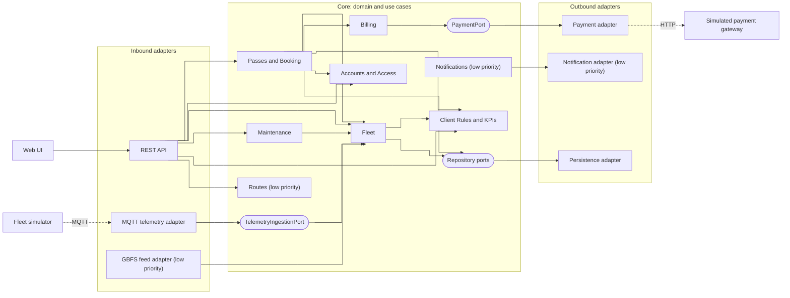
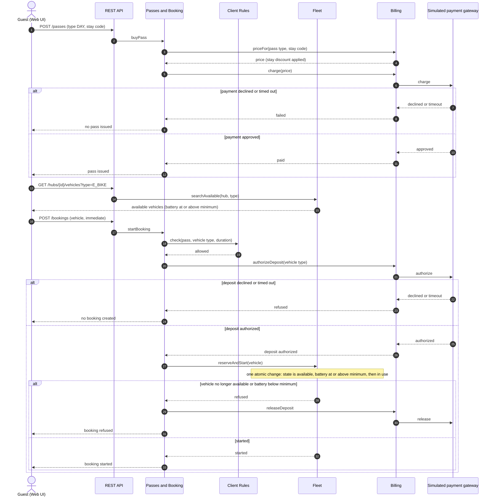
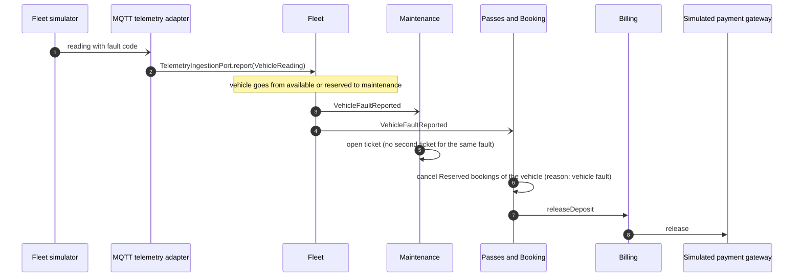

# Architecture notebook (draft)

Sections 4.1, 4.3 and 4.4 of the Product Specification report. Diagrams are Mermaid, versioned in this file, except the deployment diagram, which is PlantUML in [diagrams/deployment.puml](diagrams/deployment.puml).

## 4.1 Key requirements and constraints

The characteristics below drive the structure of the system. SLO values live in section 4.2.

| ID | Driver | Consequence for the design |
|----|--------|----------------------------|
| K1 | **Interoperability**: the fleet telemetry simulator is a separate service, and a simulator supplied by the teaching staff must be able to replace ours | Telemetry enters through one port with one adapter. The core knows nothing about MQTT or the message format |
| K2 | **Interoperability**: payments go through a simulated gateway running as a separate service | One port and adapter; a fake adapter for tests and demos |
| K3 | **Consistency**: two users may try to book the same vehicle at the same time, and telemetry keeps arriving while users book | A vehicle state change is a single atomic operation owned by one module (Fleet). It checks the vehicle state, the minimum battery and the hub capacity inside the operation, not only in the search. Telemetry and bookings go through the same operation |
| K4 | **Performance**: booking latency and telemetry lag are bounded (SLOs, section 4.2) | Telemetry is processed outside the request path; metrics exposed for k6 and monitoring |
| K5 | **Testability**: TDD, unit tests without a database or broker, time-dependent rules (pass validity, overtime, windows) | Business logic is free of Spring, JPA and MQTT. Time comes from an injected `Clock` |
| K6 | **Security**: four roles (end user or guest, operator, client manager, admin), guest personal data, payments. A field technician is an operator account with a `fieldTechnician` flag | Role-based access enforced in the API layer; payment data never stored beyond what the gateway returns |
| K7 | **Usability**: tourists use phones, several languages | One web UI over one REST API; texts are translated in the UI |
| K8 | **Modifiability**: optional later features (notifications, suggested routes, GBFS feed, identity provider) | They plug into existing ports and events without changing the core |
| K9 | **Deployability**: containers, CI/CD, staging and production | One backend container plus broker, database, telemetry simulator and payment gateway containers |
| K10 | **Measurability**: availability against the SLA and utilization are computed from how long vehicles stay in each state | Fleet records every state change and announces it as an event |

Constraints: Java 21, Spring Boot, PostgreSQL, React web UI, Docker; a team of four and five one-week iterations, so the structure favours the simplest option that satisfies K1–K10.

## 4.3 Architecture view

### System architecture

**Style: hexagonal architecture (ports and adapters), as a modular monolith.** The application is one deployable unit. Its core (domain and use cases) defines **ports**: Java interfaces that say what the core offers (inbound ports) or needs (outbound ports). **Adapters** connect the outside world to those ports: REST, MQTT, database, payment gateway. Dependencies point inwards only: adapters know the core, the core knows no adapter. The core is split into **feature modules**, each owning its data and rules.



Solid arrows are calls (dependency direction). Dependencies between modules form no cycles. Modules react to each other through **domain events** where a call would create a cycle or couple them needlessly:

| Event | Published by | Reacted to by | Why an event |
|-------|--------------|---------------|--------------|
| `VehicleFaultReported` | Fleet | Maintenance (opens a ticket); Passes and Booking (cancels the affected Reserved bookings, with reason "vehicle fault", and asks Billing to release their deposits) | Fleet must not depend on Maintenance or Booking, which both call Fleet |
| `VehicleStateChanged` | Fleet | Client Rules and KPIs (availability against the SLA, utilization) | The KPIs need how long each vehicle stayed in each state; Fleet must not know about KPIs |
| `BookingStarted`, `BookingEnded` | Passes and Booking | Client Rules and KPIs (utilization), Notifications | Read-side and side effects must not slow or break booking |
| `BookingCancelled` | Passes and Booking | Notifications | In the MVP the user sees the cancellation and its reason in the dashboard. Active notification arrives with the Notifications module |
| `TicketClosed` | Maintenance | Client Rules and KPIs (time to repair) | KPI feed only |

| Module | Responsibility |
|--------|----------------|
| Accounts and Access | Guest and registered accounts, roles (end user, operator with an optional `fieldTechnician` flag, client manager, admin), authentication |
| Fleet | Vehicles, hubs, vehicle lifecycle, relocation of vehicles between hubs (rebalancing), applying telemetry readings, state history. The only module that changes vehicle state: it checks state, minimum battery and hub capacity inside one atomic operation. Reads hub capacity and minimum battery from Client Rules |
| Passes and Booking | Pass types and passes, stay codes issued by the client and redeemed by guests, bookings and immediate starts, ending a booking at a hub, expiry and cancellation. Reads which vehicle types a pass allows from Client Rules |
| Billing | Pass price and stay discount, pass payment, deposit authorization, overtime charge, capture and release of the deposit; talks to the payment gateway through `PaymentPort` |
| Maintenance | Maintenance tickets with SLA deadlines, assignment to field technicians, closing. Two entry points: the `VehicleFaultReported` event, and a REST endpoint for operators (faults the simulator cannot detect). A vehicle cannot have two open tickets for the same fault: a manual ticket on a covered fault links to the existing ticket or is refused |
| Client Rules and KPIs | Configuration set by the client: maximum booking duration, minimum battery, hub capacities, vehicle types per pass type, deposit amounts, overtime and window parameters, SLA targets. Also the business and technical KPIs |
| Routes (low priority) | Suggested routes between hubs |
| Notifications (low priority) | Booking confirmation, end-of-use reminder, SLA breach alert, booking cancellation |

The GBFS feed (low priority) is an inbound adapter over Fleet, not a module. Rules are enforced by architecture tests (ArchUnit): the core imports no adapter or framework type, and modules call each other only through their public interfaces.

### Modules interaction

Core flow, scenario S1: a guest buys a day pass, books an e-bike, rides while telemetry arrives, ends the booking at another hub and is charged. It is shown in two diagrams, followed by a third for the fault case. The guest account already exists (`POST /guests` with name and email) and the guest holds an access token.

**Buying a pass and starting a booking.** The guest enters a stay code issued by the hotel. The deposit is authorized before any vehicle state change. If the vehicle can no longer be reserved, the authorization is released.



**Telemetry during the ride, ending the booking and charging.** A hub with no free capacity refuses the end, and the user is shown nearby hubs with room.

```mermaid
sequenceDiagram
  autonumber
  actor G as Guest (Web UI)
  participant API as REST API
  participant BK as Passes and Booking
  participant FL as Fleet
  participant BL as Billing
  participant GW as Simulated payment gateway
  participant MQ as MQTT telemetry adapter
  participant SIM as Fleet simulator

  SIM-)MQ: reading (battery, position, lock state)
  MQ->>FL: TelemetryIngestionPort.report(VehicleReading)
  Note over FL: reading applied; every state change publishes VehicleStateChanged, a fault code publishes VehicleFaultReported

  G->>API: POST /bookings/{id}/end (hub)
  API->>BK: endBooking
  BK->>FL: end(vehicle, hub)
  alt hub has no free capacity
    FL-->>BK: refused (hub full)
    BK-->>G: refused, nearby hubs with room listed
  else accepted
    FL-->>BK: vehicle available at the hub
    BK->>BL: settle(booking)
    BL->>GW: capture (overtime charge, at most the deposit)
    BL->>GW: release (remainder of the deposit)
    GW-->>BL: done
    BK-->>G: booking summary and charges
  end
```

**Fault reported while a booking is reserved.** Fleet announces the fault; Maintenance and Booking each react, and the user sees the cancellation in the dashboard.



Persistence calls are omitted for readability; every module stores its own state through repository ports.

### External integrations

| Integration | Interface (port) | Protocol | Adapter | How it is tested |
|-------------|------------------|----------|---------|------------------|
| Fleet telemetry simulator | `TelemetryIngestionPort`, owned by the core. It receives a core type `VehicleReading` (vehicle, battery, position or hub, lock state, fault, timestamp) | MQTT, one topic per vehicle, JSON payload (defined by the simulator interface contract) | `MqttTelemetryAdapter` subscribes to the broker, validates the message, translates it to `VehicleReading` and calls the port. A different simulator means a new adapter and no change to the core | Unit tests of the message translation; contract test of the JSON message against its schema; integration test with a broker in Testcontainers and a test publisher; core tests use an in-memory fake that calls the port directly; ArchUnit forbids MQTT types in the core |
| Simulated payment gateway (separate service) | `PaymentPort` (charge, authorize deposit, capture, release), owned by the core | HTTP, REST | `PaymentGatewayAdapter` calls the gateway service; `FakePaymentAdapter` (in memory) for core tests | Fake adapter in unit tests; integration tests of the adapter against the gateway service in Testcontainers with configurable outcomes (approved, declined, timeout); no external network in the default build |
| PostgreSQL | Repository ports, one set per module | JDBC | JPA persistence adapter | Integration tests against real PostgreSQL in Testcontainers |
| Identity provider (optional, not in the MVP) | Would sit behind the Accounts module's authentication port | OpenID Connect | Not built; local authentication is used | n/a |
| GBFS feed (low priority) | Reads Fleet through a query port | HTTPS, GBFS v3.0 JSON | Inbound `GbfsFeedAdapter` | Contract test against the official GBFS JSON schema |

**Replacing the simulator.** The core owns the shape of the data (`VehicleReading`) and the port. The adapter is the only code that knows the wire format. To use another simulator, write one adapter that produces `VehicleReading`s; nothing in Fleet or Booking changes, and the core test-suite already runs against a fake adapter that proves this.

## 4.4 Deployment view

**Status: planned.** This section records the configuration the team agreed on before deployment exists. The parts marked **[TBD]** are completed when deployment is in place (iteration I3, continuous delivery).

**Target environment.** Production runs on a **virtual machine provided by the teaching staff** (department VM), reachable by the teaching staff. The whole stack runs there with Docker Compose, from the same `docker-compose.yml` used in development (KAN-20), so the environment is described as code (D3).

The diagram is in [diagrams/deployment.puml](diagrams/deployment.puml). GitHub does not render PlantUML; open it with the PlantUML extension of VS Code or IntelliJ, or export it to SVG.

### Containers

All containers join one private Compose network and reach each other by service name. Only the frontend publishes a port on the VM; the database, broker, simulator, payment gateway and backend are not reachable from outside.

| Container | Technology | Role | Port | Talks to |
|-----------|------------|------|------|----------|
| `frontend` | nginx serving the React build | Web UI; forwards `/api` to the backend, so the browser talks to one origin only | 80, published | `backend` (HTTP) |
| `backend` | Java 21, Spring Boot 4 | REST API and the core (modular monolith, section 4.3) | 8080, internal | `db` (JDBC), `broker` (MQTT), `payment-gateway` (HTTP) |
| `db` | PostgreSQL | Persistence of every module | 5432, internal | none |
| `broker` | MQTT broker **[TBD]** | Carries telemetry from the simulator to the backend | 1883, internal | none |
| `simulator` | Fleet telemetry simulator **[stack TBD]** | Publishes vehicle readings (battery, position, lock state, faults) | none | `broker` (MQTT) |
| `payment-gateway` | Simulated payment gateway **[stack TBD]** | Charges, authorizes, captures and releases deposits | internal **[TBD]** | none |

The database keeps its data in the named volume `db-data`, so data survives a restart or a rebuild of the containers. Credentials come from a git-ignored `.env` file on each machine; the repository holds only `.env.example` with placeholder values.

### Consistency with the other views

- Each external integration of section 4.3 is one container here: the fleet simulator and the broker (telemetry, MQTT), the simulated payment gateway (HTTP), PostgreSQL (JDBC).
- The core and its adapters are one deployable unit, the `backend` container, as the modular monolith style requires.
- Container names, ports and the volume must match `docker-compose.yml` (KAN-20). When one changes, the other changes in the same pull request.

### To be completed when deployment is in place

- [TBD] VM host name or IP address, and whether the frontend is served over HTTPS.
- [TBD] How `main` reaches the VM (continuous delivery, D4): the deployment job in GitHub Actions and how it connects to the VM.
- [TBD] Representative data loaded on deployment (D4).
- [TBD] Staging next to production (D5, valued): for example a second Compose project on the same VM with other ports.
- [TBD] MQTT broker product, simulator and payment gateway stacks, and image versions.
- [TBD] Observability containers if adopted (D6, valued: Prometheus and Grafana).
