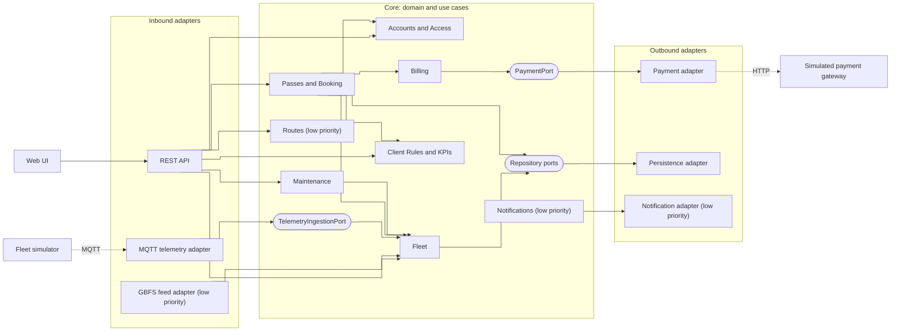
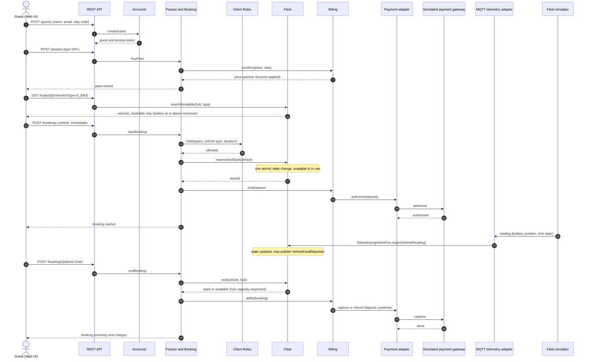

# Architecture notebook (draft)

Sections 4.1 and 4.3 of the Product Specification report. Diagrams are Mermaid, versioned in this file.

## 4.1 Key requirements and constraints

The characteristics below drive the structure of the system. SLO values live in section 4.2.

| ID | Driver | Consequence for the design |
|----|--------|----------------------------|
| K1 | **Interoperability**: the fleet telemetry simulator is a separate service, and a simulator supplied by the teaching staff must be able to replace ours | Telemetry enters through one port with one adapter. The core knows nothing about MQTT or the message format |
| K2 | **Interoperability**: payments go through a simulated gateway running as a separate service | One port and adapter; a fake adapter for tests and demos |
| K3 | **Consistency**: two users may try to book the same vehicle at the same time, and telemetry keeps arriving while users book | A vehicle state change is a single atomic operation owned by one module (Fleet). Telemetry and bookings go through the same operation |
| K4 | **Performance**: booking latency and telemetry lag are bounded (SLOs) | Telemetry is processed outside the request path; metrics exposed for k6 and monitoring |
| K5 | **Testability**: TDD, unit tests without a database or broker, time-dependent rules (pass validity, overtime) | Business logic is free of Spring, JPA and MQTT. Time comes from an injected `Clock` |
| K6 | **Security**: four roles (end user or guest, operator including technician, client manager, admin), guest personal data, payments | Role-based access enforced in the API layer; payment data never stored beyond what the gateway returns |
| K7 | **Usability**: tourists use phones, several languages | One web UI over one REST API; texts are translated in the UI |
| K8 | **Modifiability**: optional later features (notifications, suggested routes, GBFS feed, identity provider) | They plug into existing ports and events without changing the core |
| K9 | **Deployability**: containers, CI/CD, staging and production | One backend container plus broker, database and simulator containers |

Constraints: Java 21, Spring Boot, PostgreSQL, React web UI, Docker; a team of four and five one-week iterations, so the structure favours the simplest option that satisfies K1–K9.

## 4.3 Architecture view

### System architecture

**Style: hexagonal architecture (ports and adapters), as a modular monolith.** The application is one deployable unit. Its core (domain and use cases) defines **ports**: Java interfaces that say what the core offers (inbound ports) or needs (outbound ports). **Adapters** connect the outside world to those ports: REST, MQTT, database, payment gateway. Dependencies point inwards only: adapters know the core, the core knows no adapter. The core is split into **feature modules**, each owning its data and rules.

Solid arrows are calls (dependency direction). Dependencies between modules form no cycles. Modules react to each other through **domain events** where a call would create a cycle or couple them needlessly:

| Event | Published by | Reacted to by | Why an event |
|-------|--------------|---------------|--------------|
| `VehicleFaultReported` | Fleet | Maintenance (opens a ticket) | Fleet must not depend on Maintenance, which already calls Fleet |
| `BookingStarted`, `BookingEnded` | Passes and Booking | Client Rules and KPIs (utilization), Notifications | Read-side and side effects must not slow or break booking |
| `TicketClosed` | Maintenance | Client Rules and KPIs (time to repair) | KPI feed only |

| Module | Responsibility |
|--------|----------------|
| Accounts and Access | Guests and registered users, roles, authentication |
| Fleet | Vehicles, hubs, vehicle lifecycle, hub capacity, applying telemetry readings. The only module that changes vehicle state |
| Passes and Booking | Passes (price, validity), bookings (including immediate start), ending a booking at a hub |
| Billing | Pass price and partner discount, deposit, overtime charge; talks to the payment gateway through `PaymentPort` |
| Maintenance | Maintenance tickets, SLA deadlines, assignment, closing |
| Client Rules and KPIs | Rules of use set by the client (maximum duration, vehicle types per pass, hub quotas) and the business and technical KPIs |
| Routes (low priority) | Suggested routes between hubs |
| Notifications (low priority) | Booking confirmation, end-of-use reminder, SLA breach alert |

The GBFS feed (low priority) is an inbound adapter over Fleet, not a module. Rules are enforced by architecture tests (ArchUnit): the core imports no adapter or framework type, and modules call each other only through their public interfaces.

### Modules interaction

Core flow, scenario S1: a guest buys a day pass, books an e-bike, rides while telemetry arrives, ends the booking at another hub and is charged.

Persistence calls are omitted for readability; every module stores its own state through repository ports.

### External integrations

| Integration | Interface (port) | Protocol | Adapter | How it is tested |
|-------------|------------------|----------|---------|------------------|
| Fleet telemetry simulator | `TelemetryIngestionPort`, owned by the core. It receives a core type `VehicleReading` (vehicle, battery, position or hub, lock state, fault, timestamp) | MQTT, one topic per vehicle, JSON payload (defined by the simulator interface contract) | `MqttTelemetryAdapter` subscribes to the broker, validates the message, translates it to `VehicleReading` and calls the port. A different simulator means a new adapter and no change to the core | Unit tests of the message translation; contract test of the JSON message against its schema; integration test with a broker in Testcontainers and a test publisher; core tests use an in-memory fake that calls the port directly; ArchUnit forbids MQTT types in the core |
| Simulated payment gateway (separate service) | `PaymentPort` (authorize deposit, capture, release), owned by the core | HTTP, REST | `PaymentGatewayAdapter` calls the gateway service; `FakePaymentAdapter` (in memory) for core tests | Fake adapter in unit tests; integration tests of the adapter against the gateway service in Testcontainers with configurable outcomes (approved, declined, timeout); no external network in the default build |
| PostgreSQL | Repository ports, one set per module | JDBC | JPA persistence adapter | Integration tests against real PostgreSQL in Testcontainers |
| Identity provider (optional, not in the MVP) | Would sit behind the Accounts module's authentication port | OpenID Connect | Not built; local authentication is used | n/a |
| GBFS feed (low priority) | Reads Fleet through a query port | HTTPS, GBFS v3.0 JSON | Inbound `GbfsFeedAdapter` | Contract test against the official GBFS JSON schema |

**Replacing the simulator.** The core owns the shape of the data (`VehicleReading`) and the port. The adapter is the only code that knows the wire format. To use another simulator, write one adapter that produces `VehicleReading`s; nothing in Fleet or Booking changes, and the core test-suite already runs against a fake adapter that proves this.
