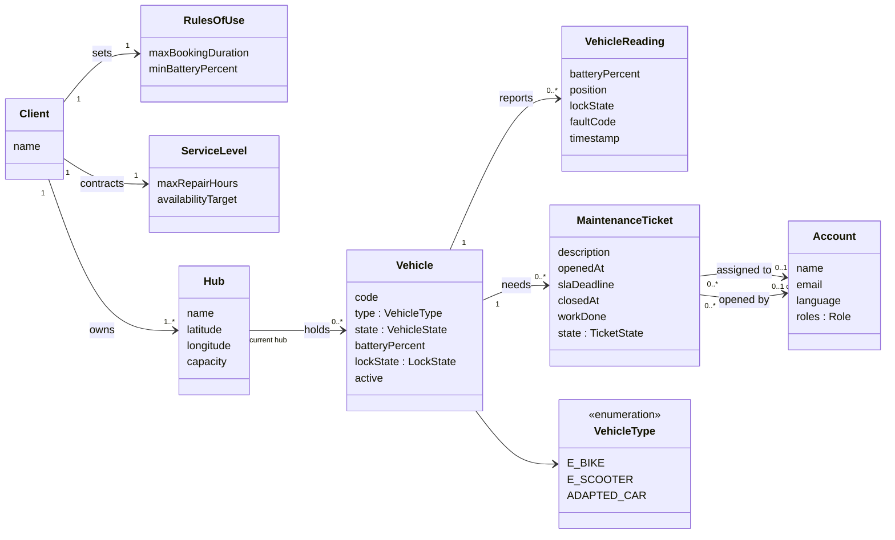
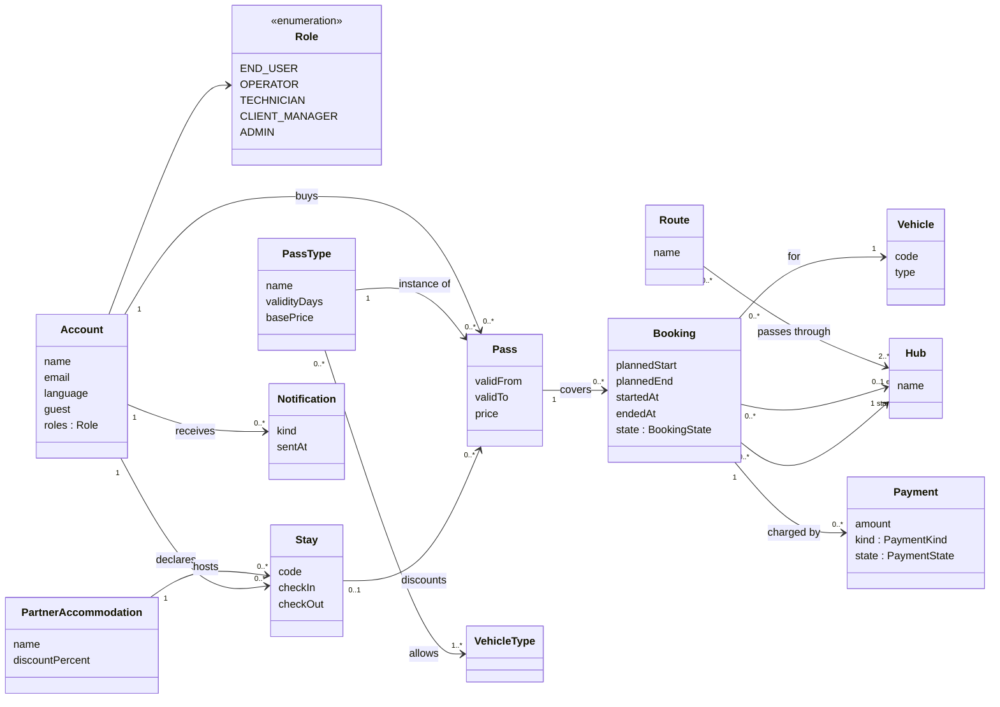
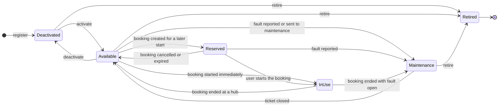
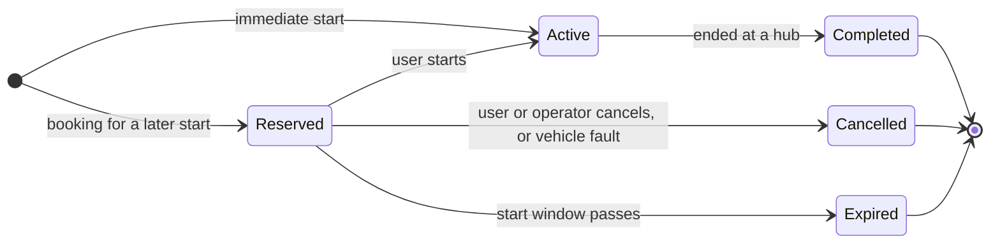
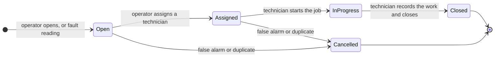
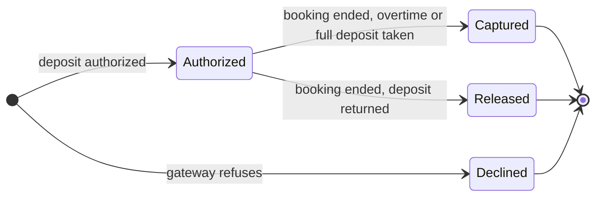

# Domain model (draft)

Sections 3.1 and 3.3 of the Product Specification report (KAN-26). Mermaid sources, versioned in this file.

## 3.1 Conceptual model

Logical model (UML class diagram) of the information the platform manages. It is not a database model: no keys, no join tables. Types are conceptual. `<<enumeration>>` lists the allowed values of an attribute. Module names match the architecture view (4.3).

The model is shown in two views to stay readable. Classes that appear in both are repeated.

### View 1: fleet, hubs, maintenance and client rules

### View 2: accounts, passes, bookings and payments

### Concepts

| Concept | Module | Description |
|---------|--------|-------------|
| Account | Accounts and Access | A person using the platform. A guest is an account created with name and email only, with no institutional identity. Roles define what the person may do |
| Role | Accounts and Access | END_USER, OPERATOR, TECHNICIAN (an operator who works tickets in the field), CLIENT_MANAGER, ADMIN |
| Client | Client Rules and KPIs | The institution that contracts the service (the hotel group). Owns the hubs and sets the rules |
| RulesOfUse | Client Rules and KPIs | Rules the client defines: maximum booking duration, minimum battery to book |
| ServiceLevel | Client Rules and KPIs | The contracted SLA: maximum repair time for maintenance tickets and the availability target used by the KPIs |
| Hub | Fleet | A place where vehicles are picked up and returned, with a location and a capacity (how many vehicles it holds) |
| Vehicle | Fleet | A fleet vehicle: type, lifecycle state, last known battery level and lock state. Held by one hub, or by none while in use |
| VehicleType | Fleet | E_BIKE, E_SCOOTER, ADAPTED_CAR (adapted car for people with reduced mobility, lowest priority) |
| VehicleReading | Fleet | A telemetry reading about a vehicle: battery, position or hub, lock state, fault code, timestamp. Applied to the vehicle; readings are not kept as business data |
| MaintenanceTicket | Maintenance | A repair job for one vehicle with an SLA deadline, an optional technician, and a record of the work done when closed. Time to repair is measured from it |
| PartnerAccommodation | Passes and Booking | A hotel or accommodation of the client's group whose guests receive a discount |
| Stay | Passes and Booking | A guest's stay at a partner accommodation, identified by a code. Proves eligibility for the discount |
| PassType | Passes and Booking | A kind of pass (day, multi-day): validity in days, base price, and the vehicle types it allows |
| Pass | Passes and Booking | A pass bought by an account: validity period and the price after any stay discount |
| Booking | Passes and Booking | The right to use one vehicle, for a planned period or starting immediately: start and end hub, planned and actual times, state |
| Payment | Billing | A money movement tied to a booking: the deposit and any overtime charge, with its state |
| Route | Routes (low priority) | A suggested route through an ordered sequence of hubs |
| Notification | Notifications (low priority) | A message sent to an account (confirmation, reminder, SLA alert) |

Key derived values, not stored as concepts: the booking's overtime and charge breakdown, the business KPIs (utilization, availability against the SLA, bookings per day, time to repair) and the technical KPIs (API latency, error rate, telemetry lag).

## 3.3 Special lifecycles

Mermaid state diagrams have no line-style option, so the layout follows the tool.

### Vehicle lifecycle

A vehicle is **bookable** only in Available, and then only if its battery is at or above the minimum.

| From | To | Trigger | Condition |
|------|----|---------|-----------|
| (new) | Deactivated | Operator registers the vehicle | Hub and type given |
| Deactivated | Available | Operator activates the vehicle | No open maintenance ticket |
| Available | Deactivated | Operator deactivates the vehicle | |
| Available | Reserved | User creates a booking starting later | Battery at or above the minimum |
| Available | InUse | User starts an immediate booking | Battery at or above the minimum, rules of use satisfied |
| Reserved | InUse | User starts the booking | Within the booking's start window |
| Reserved | Available | User or operator cancels, or the start window passes | |
| InUse | Available | User ends the booking at a hub | Hub has free capacity, vehicle locked |
| Available | Maintenance | A fault reading arrives, or the operator sends the vehicle to maintenance | A ticket is opened |
| Reserved | Maintenance | A fault reading arrives | The booking is cancelled |
| InUse | Maintenance | User ends the booking | A fault is open |
| Maintenance | Available | Technician closes the ticket | |
| Deactivated, Available, Maintenance | Retired | Operator retires the vehicle | No active booking; retirement is final |

Activation always leads to Available; a vehicle never resumes an earlier state. Vehicles cannot be deactivated while Reserved or InUse: the booking has to be cancelled or ended first.

### Booking lifecycle

Overtime is not a state: a booking that ends after its planned end stays Active until the user ends it, and the overtime charge is computed at that moment.

### Maintenance ticket lifecycle

Missing the SLA deadline does not change the state; it marks the ticket as breached for the KPIs and alerts.

### Payment lifecycle

