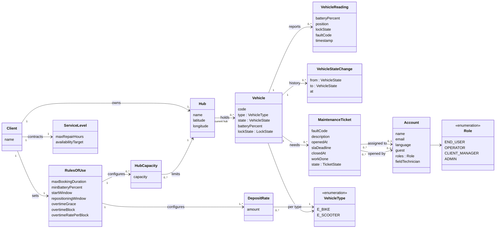
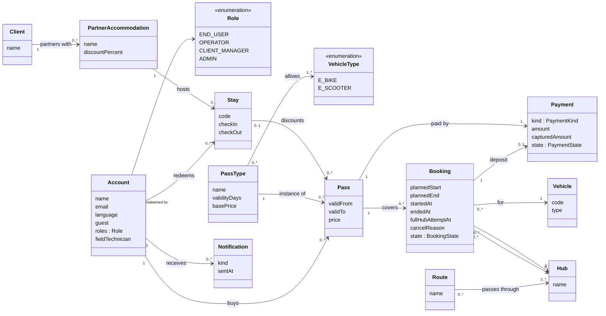
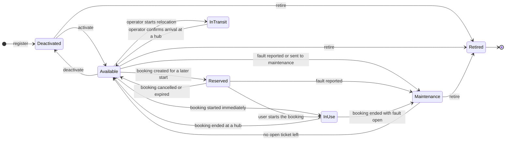
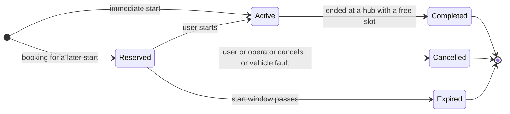
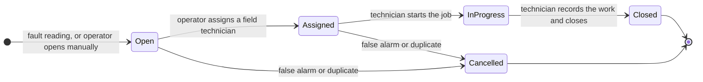
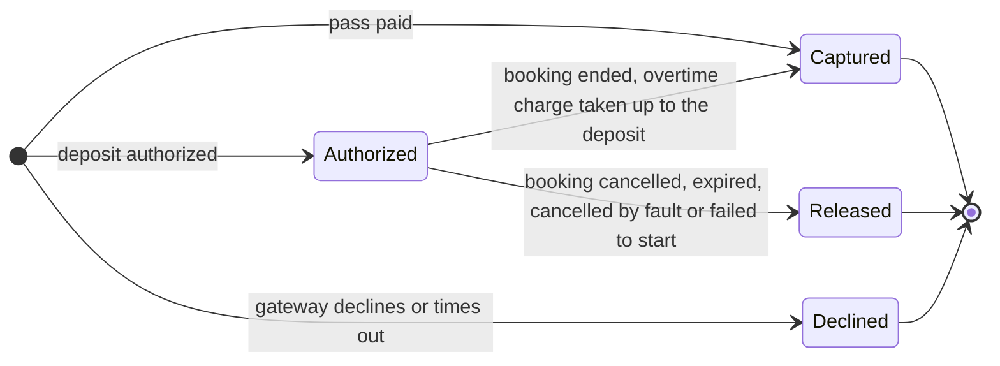

# Domain model (draft)

Sections 3.1 and 3.3 of the Product Specification report (KAN-26). Mermaid sources, versioned in this file.

## 3.1 Conceptual model

Logical model (UML class diagram) of the information the platform manages. It is not a database model: no keys, no join tables. Types are conceptual. `<<enumeration>>` lists the allowed values of an attribute. Module names match the architecture view (4.3).

The model is shown in two views to stay readable. Classes that appear in both are repeated.

### View 1: fleet, hubs, maintenance and client rules

### View 2: accounts, passes, bookings and payments

### Concepts

| Concept | Module | Description |
|---------|--------|-------------|
| Account | Accounts and Access | A person using the platform. A guest is an account created with name and email only, with no institutional identity. Roles define what the person may do. A field technician is an OPERATOR account with `fieldTechnician` set |
| Role | Accounts and Access | END_USER, OPERATOR, CLIENT_MANAGER, ADMIN |
| Client | Client Rules and KPIs | The institution that contracts the service (the hotel group). Owns the hubs, sets the rules and issues the stay codes of its partner accommodations |
| RulesOfUse | Client Rules and KPIs | Configuration the client edits: maximum booking duration, minimum battery to book, start window of a reservation, repositioning window after a refused return, and the overtime parameters (grace period, block length, rate per block) |
| DepositRate | Client Rules and KPIs | Deposit amount for one vehicle type |
| HubCapacity | Client Rules and KPIs | How many vehicles one hub holds, as configured by the client. Fleet reads it when a vehicle is registered, returned or relocated |
| ServiceLevel | Client Rules and KPIs | The contracted SLA: maximum repair time for maintenance tickets and the availability target used by the KPIs |
| Hub | Fleet | A place where vehicles are picked up and returned, with a location. Its capacity comes from HubCapacity |
| Vehicle | Fleet | A fleet vehicle: type, lifecycle state, last known battery level and lock state. Held by one hub, or by none while in use or in transit |
| VehicleType | Fleet | E_BIKE, E_SCOOTER |
| VehicleReading | Fleet | A telemetry reading about a vehicle: battery, position or hub, lock state, fault code, timestamp. Applied to the vehicle; readings are not kept as business data |
| VehicleStateChange | Fleet | One entry in a vehicle's state history (from, to, when). It is the source of the availability and utilization KPIs |
| MaintenanceTicket | Maintenance | A repair job for one vehicle and fault, opened automatically from a fault reading or manually by an operator, with an SLA deadline, an optional technician, and a record of the work done when closed. Time to repair is measured from it |
| PartnerAccommodation | Passes and Booking | A hotel or accommodation of the client's group whose guests receive a discount |
| Stay | Passes and Booking | A guest's stay at a partner accommodation, identified by a code issued by the client. The guest enters the code when buying a pass. A code links to one account only and is valid for purchases between check-in and check-out |
| PassType | Passes and Booking | A kind of pass (day, multi-day): validity in days, base price, and the vehicle types it allows (configured in Client Rules and KPIs) |
| Pass | Passes and Booking | A pass bought by an account and paid through Billing: validity period and the price after any stay discount |
| Booking | Passes and Booking | The right to use one vehicle, for a planned period or starting immediately: start and end hub, planned and actual times, state. Records the time of the first refused return at a full hub and the reason when cancelled |
| Payment | Billing | A money movement: the payment of a pass, or the deposit of a booking. A deposit is authorized, then captured up to the overtime charge and released for the rest |
| Route | Routes (low priority) | A suggested route through an ordered sequence of hubs |
| Notification | Notifications (low priority) | A message sent to an account (confirmation, reminder, SLA alert, cancellation) |

Key derived values, not stored as concepts: the booking's overtime and charge breakdown, the business KPIs (utilization, availability against the SLA, bookings per day, time to repair) and the technical KPIs (API latency, error rate, telemetry lag).

## 3.3 Special lifecycles

Mermaid state diagrams have no line-style option, so the layout follows the tool.

### Vehicle lifecycle

A vehicle is **bookable** only in Available, and then only if its battery is at or above the minimum. A vehicle in InTransit is being moved between hubs by the operator and belongs to no hub.

| From | To | Trigger | Condition |
|------|----|---------|-----------|
| (new) | Deactivated | Operator registers the vehicle | Hub and type given; the hub has a free slot |
| Deactivated | Available | Operator activates the vehicle | No open maintenance ticket |
| Available | Deactivated | Operator deactivates the vehicle | |
| Available | Reserved | User creates a booking starting later | Battery at or above the minimum, checked in the atomic state change |
| Available | InUse | User starts an immediate booking | Battery at or above the minimum, checked in the atomic state change; rules of use satisfied |
| Reserved | InUse | User starts the booking | Within the booking's start window; only the booking that reserved the vehicle |
| Reserved | Available | User or operator cancels, or the start window passes | Deposit released |
| InUse | Available | User ends the booking at a hub | Hub has a free slot, vehicle locked. If the hub is full the end is refused, the vehicle stays InUse and the time of the first refusal is recorded on the booking |
| Available | Maintenance | A fault reading arrives, or an operator opens a manual ticket and sends the vehicle to maintenance | A ticket is opened |
| Reserved | Maintenance | A fault reading arrives | The booking is cancelled (reason "vehicle fault") and its deposit released |
| InUse | Maintenance | User ends the booking | A fault is open; the ride is not interrupted |
| Maintenance | Available | A technician closes a ticket, or a ticket is cancelled | No other ticket is open for the vehicle |
| Available | InTransit | Operator starts moving the vehicle to another hub | No active booking |
| InTransit | Available | Operator confirms arrival | Destination hub has a free slot |
| Deactivated, Available, Maintenance | Retired | Operator retires the vehicle | No active booking; retirement is final |

Activation always leads to Available; a vehicle never resumes an earlier state. Vehicles cannot be deactivated while Reserved or InUse: the booking has to be cancelled or ended first.

### Booking lifecycle

Overtime is not a state: a booking that ends after its planned end stays Active until the user ends it, and the overtime charge is computed at that moment. A refused end at a full hub keeps the booking Active and records the time of the first refusal; overtime is counted up to that time if the user ends the booking at another hub within the repositioning window.

### Maintenance ticket lifecycle

Closing needs a non-empty record of the work done. Missing the SLA deadline does not change the state; it marks the ticket as breached for the KPIs and alerts. When a ticket is closed or cancelled, the vehicle leaves Maintenance only if no other ticket is open for it.

### Payment lifecycle

A pass payment is captured at once or declined; no pass is issued when it is declined. A deposit is authorized before any vehicle state change. When the booking ends, the overtime charge is captured up to the deposit and the rest of the deposit is released in the same step.
